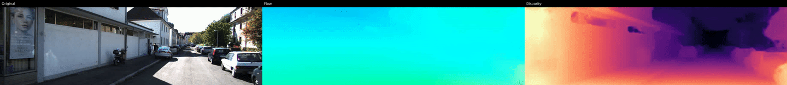

# StructFlow

## A Unified Guidance Paradigm for Consistent Disparity and Flow Estimation

StructFlow is an unsupervised joint optical flow and stereo disparity estimation framework designed to promote crosstask structural consistency. It combines shared structural features with task-specific correspondence estimation and structure-guided propagation, allowing motion and stereo geometry to reinforce one another while retaining task-appropriate prediction heads. 

## Demonstration Videos

The following continuous [KITTI Raw](https://www.cvlibs.net/datasets/kitti/raw_data.php) drive visualization uses genuine consecutive stereo frames. Every frame is rendered as **Original | Flow | Disparity** using our StructFlow flow and disparity predictions.

[](visualization/videos/kitti_demo_original_flow_disparity_original_hsv.mp4)

*KITTI Demonstration — [Open the full-quality MP4](visualization/videos/kitti_demo_original_flow_disparity_original_hsv.mp4).* 

Recreate it with the command in [README-reproduce.md](README-reproduce.md). See [Visualization Samples](visualization/README.md) for paired local inputs.

## Installation and Environment

```bash
git clone <STRUCTFLOW-REPOSITORY-URL>
cd structflow-code-github
conda create -n structflow python=3.11
conda activate structflow
pip install -r requirements.txt
```

## Datasets

Configure local roots in `dataset_paths.py`.

| Dataset | Role | Official download |
| --- | --- | --- |
| KITTI 2012 | Optical flow evaluation and visualization | [KITTI Flow 2012](https://www.cvlibs.net/datasets/kitti/eval_flow.php?benchmark=flow) |
| KITTI 2015 | Optical flow, depth/disparity, and KITTI Raw videos | [KITTI Scene Flow 2015](https://www.cvlibs.net/datasets/kitti/eval_scene_flow.php?benchmark=flow) |
| MPI Sintel | Optical flow evaluation and stereo visualization | [MPI Sintel](https://sintel.is.tue.mpg.de/downloads) |
| FlyingThings3D | Cross-dataset flow and disparity evaluation | [Scene Flow Datasets](https://lmb.informatik.uni-freiburg.de/resources/datasets/SceneFlowDatasets.en.html) |
| Spring | Local cross-dataset subset and official benchmark | [Spring download](https://spring-benchmark.org/download) |

## Pretrained Checkpoints

| Dataset / use | Task | Checkpoint |
| --- | --- | --- |
| KITTI 2015, Sintel, Table VI KITTI-only flow | Optical Flow | [`kitti15-main-flow.pth.tar`](checkpoints/main-results/flow/kitti15-main-flow.pth.tar) |
| KITTI 2012 | Optical Flow | [`kitti12-main-flow.pth.tar`](checkpoints/main-results/flow/kitti12-main-flow.pth.tar) |
| FlyingThings3D / Spring adaptation | Joint flow and disparity | [`flyingthings3d-spring-transfer-flow.pth.tar`](checkpoints/main-results/flow/flyingthings3d-spring-transfer-flow.pth.tar) |
| KITTI 2015 / Eigen | Depth/Disparity | [`kitti15-main-depth.pth.tar`](checkpoints/main-results/depth/kitti15-main-depth.pth.tar) |

See [checkpoint details](checkpoints/README-checkpoints.md) for the complete mapping.

## Reproducing Main Quantitative Results

Each command performs inference, prints the calculated values, and writes a timestamped directory beneath `outputs/`. 
### KITTI 2015 - Depth/Disparity

`kitti15-main-depth.pth.tar` on the KITTI 2015 training split:

```bash
python -u core/evaluate.py --table II --device cuda:1
```

| Abs Rel | Sq Rel | RMSE | RMSE log | delta1 | delta2 | delta3 |
| ---: | ---: | ---: | ---: | ---: | ---: | ---: |
| 0.04689 | 0.42830 | 3.33897 | 0.11610 | 0.96386 | 0.98443 | 0.99227 |

### KITTI Eigen - Depth

`kitti15-main-depth.pth.tar` on the retained Eigen split:

```bash
python -u core/evaluate.py --table III --device cuda:1
```

| Abs Rel | Sq Rel | RMSE | RMSE log | delta1 | delta2 | delta3 |
| ---: | ---: | ---: | ---: | ---: | ---: | ---: |
| 0.07596 | 0.68883 | 4.08505 | 0.17213 | 0.92384 | 0.96257 | 0.97978 |

### KITTI 2015 - Optical Flow

`kitti15-main-flow.pth.tar` on the KITTI 2015 training split:

```bash
python -u core/evaluate.py --table IV --device cuda:1
```

| EPE-all | EPE-match | EPE-unmatch | F1 |
| ---: | ---: | ---: | ---: |
| 4.13001 | 3.14229 | 8.77782 | 11.62403 |

### KITTI 2012 - Optical Flow

`kitti12-main-flow.pth.tar` on the KITTI 2012 training split:

```bash
python -u core/evaluate.py --table IV-KITTI2012 --device cuda:1
```

| EPE-all | EPE-match | EPE-unmatch | F1 |
| ---: | ---: | ---: | ---: |
| 1.32839 | 0.84989 | 4.17260 | 4.16381 |

### Sintel Final - Optical Flow

`kitti15-main-flow.pth.tar` on the Sintel Final split:

```bash
python -u core/evaluate.py --table V --device cuda:1
```

| EPE-all | F1 |
| ---: | ---: |
| 7.90459 | 24.97045 |

### FlyingThings3D - Optical Flow

The retained validation manifest supports the KITTI-only and adapted models:

```bash
python -u core/evaluate.py --table VI-FT3D-KITTI-FLOW --device cuda:1
python -u core/evaluate.py --table VI-FT3D-ADAPTED-FLOW --device cuda:1
```

| Model | EPE-all | F1 |
| --- | ---: | ---: |
| KITTI-only | 3.64945 | 22.47130 |
| Adapted | 2.73090 | 16.10746 |

### FlyingThings3D - Disparity

The same retained validation manifest is used for both rows:

```bash
python -u core/evaluate.py --table VI-FT3D-KITTI-DISP --device cuda:1
python -u core/evaluate.py --table VI-FT3D-ADAPTED-DISP --device cuda:1
```

| Model | MAE | D1 |
| --- | ---: | ---: |
| KITTI-only | 9.25320 | 34.69917 |
| Adapted | 6.54913 | 21.41225 |

### Spring - Optical Flow

#### KITTI-only Spring Optical Flow

```bash
python -u core/evaluate.py --table VI-SPRING-KITTI-FLOW --device cuda:1
```


| EPE | F1 |
| ---: | ---: |
| 5.15 | 32.29 |

#### Adapted Spring Optical Flow

```bash
python -u core/evaluate.py --table VI-SPRING-ADAPTED-FLOW --device cuda:1
```


| EPE | F1 |
| ---: | ---: |
| 2.30 | 24.81 |

### Spring - Disparity

#### Adapted Spring Disparity

```bash
python -u core/evaluate.py --table VI-SPRING-ADAPTED-DISP --device cuda:1
```


| MAE | D1 |
| ---: | ---: |
| 5.98 | 60.83 |

## Spring Benchmark Results

Table VII is the public test-server result, distinct from the local Spring evaluation above. Inspect the [StructFlow submission](https://spring-benchmark.org/427/) and the [official leaderboard](https://spring-benchmark.org/opticalflow).

| Evaluation set | EPE | Fl-all |
| --- | ---: | ---: |
| Official Spring test set | 13.850 | 38.349 |

## Optical Flow and Depth/Disparity Visualization

`core/visualize.py` renders final flow and disparity predictions from paired stereo inputs.

### KITTI 2012 — Optical Flow

```bash
python -u core/visualize.py --dataset kitti2012 --task flow --input visualization/samples/kitti2012 --checkpoint checkpoints/main-results/flow/kitti12-main-flow.pth.tar --output visualization/results/kitti2012/flow --device cuda:1 --max-pairs 1 --overwrite
```


### KITTI 2015 — Optical Flow

```bash
python -u core/visualize.py --dataset kitti2015 --task flow --input visualization/samples/kitti2015/benchmark --checkpoint checkpoints/main-results/flow/kitti15-main-flow.pth.tar --output visualization/results/kitti2015/flow --device cuda:1 --max-pairs 1 --overwrite
```


### KITTI 2015 — Disparity

```bash
python -u core/visualize.py --dataset kitti2015 --task disp --input visualization/samples/kitti2015/raw_drive --checkpoint checkpoints/main-results/depth/kitti15-main-depth.pth.tar --output visualization/results/kitti2015/disp --device cuda:1 --max-pairs 1 --overwrite
```


### MPI Sintel — Optical Flow

```bash
python -u core/visualize.py --dataset sintel --task flow --input visualization/samples/sintel/alley_1 --checkpoint checkpoints/main-results/flow/kitti15-main-flow.pth.tar --output visualization/results/sintel/flow --device cuda:1 --max-pairs 1 --overwrite
```


### MPI Sintel — Disparity

```bash
python -u core/visualize.py --dataset sintel --task disp --input visualization/samples/sintel/alley_1 --checkpoint checkpoints/main-results/depth/kitti15-main-depth.pth.tar --output visualization/results/sintel/disp --device cuda:1 --max-pairs 1 --overwrite
```


### FlyingThings3D — Optical Flow

```bash
python -u core/visualize.py --dataset flyingthings3d --task flow --input visualization/samples/flyingthings3d/C_0001 --checkpoint checkpoints/main-results/flow/flyingthings3d-spring-transfer-flow.pth.tar --output visualization/results/flyingthings3d/flow --device cuda:1 --max-pairs 1 --overwrite
```


### FlyingThings3D — Disparity

```bash
python -u core/visualize.py --dataset flyingthings3d --task disp --input visualization/samples/flyingthings3d/C_0001 --checkpoint checkpoints/main-results/flow/flyingthings3d-spring-transfer-flow.pth.tar --output visualization/results/flyingthings3d/disp --device cuda:1 --max-pairs 1 --overwrite
```


### Spring — Optical Flow

```bash
python -u core/visualize.py --dataset spring --task flow --input visualization/samples/spring/0001 --checkpoint checkpoints/main-results/flow/flyingthings3d-spring-transfer-flow.pth.tar --output visualization/results/spring/flow --device cuda:1 --max-pairs 1 --overwrite
```


### Spring — Disparity

```bash
python -u core/visualize.py --dataset spring --task disp --input visualization/samples/spring/0001 --checkpoint checkpoints/main-results/flow/flyingthings3d-spring-transfer-flow.pth.tar --output visualization/results/spring/disp --device cuda:1 --max-pairs 1 --overwrite
```


## Boundary Analysis

### Table XII — Boundary-region distribution

This calculation recomputes shared, flow-only, and disparity-only 90th-percentile boundary bands from KITTI 2015 ground truth.

```bash
python -u core/evaluate_boundary.py
```

**Manuscript Results**

| Region | Valid pixels | Boundary-band share |
| --- | ---: | ---: |
| Shared | 17.31% | 51.84% |
| Flow-only | 6.41% | 19.20% |
| Disparity-only | 9.67% | 28.96% |
| Non-boundary control | 9.63% | - |

### Table XIII — Learned GSPN and SFIN responses

This calculation reruns StructFlow on the recovered ordered 40-sample KITTI 2015 experiment.

```bash
python -u core/evaluate_boundary.py --table XIII --device cuda:1
```

**Manuscript Results**

| Module and measure | Shared region | Comparison region |
| --- | ---: | ---: |
| GSPN x4 retained ratio | 92.5% | 56.0% non-shared |
| GSPN x5 retained ratio | 51.5% | 35.1% non-shared |
| SFIN attention mean | 0.086 | 0.031 non-boundary |


## Citation

Publication metadata is not present in the supplied manuscript. Cite the work as a manuscript until venue, year, and DOI information are available:

```bibtex
@article{structflow,
  title={StructFlow: A Unified Guidance Paradigm for Consistent Disparity and Flow Estimation},
  author={Abdein, Rokia and Li, Wei and Qu, Yingnan and Zhang, Xinyan and Helal, Sumi and Youssef, Moustafa},
  note={Manuscript}
}
```
